# Lambda Fleet

Architecture Lambda pour l'analyse de données télémétriques de véhicules.
Le projet combine une couche temps réel, une couche batch et une couche de
restitution, le tout déployé avec Docker Compose.

## 1. Vue d'ensemble

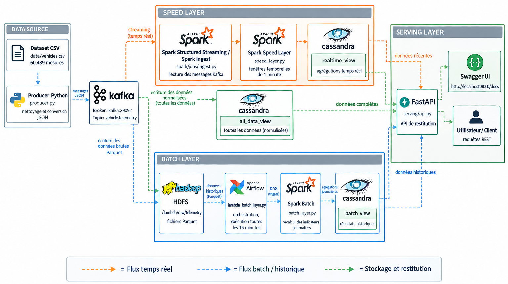

Le flux de données est le suivant :

```text
data/vehicles.csv
        |
        v
producer/producer.py
        |
        v
Kafka : vehicle.telemetry
        |
        +----------------------+
        |                      |
        v                      v
Spark Ingest             Spark Speed Layer
        |                      |
        +----------+-----------+
                   |
        +----------+-----------+
        |                      |
        v                      v
Cassandra                 HDFS
all_data_view             /lambda/raw/telemetry
realtime_view                   |
                                v
                         Airflow + Spark Batch
                                |
                                v
                         Cassandra batch_view
                                |
                                v
                         FastAPI / Swagger
```

## 2. Objectifs

- Simuler un flux de télémétrie de véhicules à partir d'un fichier CSV.
- Publier les événements dans Kafka.
- Traiter les événements avec Spark Structured Streaming.
- Conserver les événements bruts dans Cassandra et HDFS.
- Calculer des agrégations temps réel par fenêtre d'une minute.
- Recalculer les indicateurs historiques avec Spark Batch et Airflow.
- Exposer les résultats avec une API FastAPI.
- Superviser les composants avec leurs interfaces Web.

## 3. Technologies et images Docker

| Composant | Image ou technologie | Rôle |
|---|---|---|
| Orchestration | Docker Compose | Démarrage et réseau des services |
| Coordination Kafka | `confluentinc/cp-zookeeper:7.6.1` | Coordination du broker |
| Message broker | `confluentinc/cp-kafka:7.6.1` | Topic `vehicle.telemetry` |
| Schema Registry | `confluentinc/cp-schema-registry:7.6.1` | Registry des schémas |
| Monitoring Kafka | `confluentinc/cp-enterprise-control-center:7.6.1` | Interface Kafka |
| Streaming et batch | `apache/spark:3.5.6-python3` | Traitement des données |
| Stockage distribué | `apache/hadoop:3.3.6` | HDFS |
| Base NoSQL | `cassandra:5.0` | Vues brutes, temps réel et batch |
| Orchestration batch | `apache/airflow:2.10.5` | Planification du DAG |
| Métadonnées Airflow | `postgres:16` | Base interne Airflow |
| Producteur | `producer/Dockerfile` | Publication des données |
| API | `serving/Dockerfile` | Service FastAPI |

## 4. Arborescence

```text
lambda-fleet/
├── docker-compose.yml
├── README.md
├── data/
│   ├── vehicles.csv
│   └── README.md
├── producer/
│   ├── Dockerfile
│   ├── mapping.json
│   ├── producer.py
│   └── requirements.txt
├── spark/
│   └── jobs/
│       ├── common.py
│       ├── ingest.py
│       ├── speed_layer.py
│       └── batch_layer.py
├── cassandra/
│   └── schema.cql
├── hadoop/
│   └── hadoop.env
├── airflow/
│   ├── Dockerfile
│   └── dags/
│       └── lambda_batch_layer.py
├── serving/
│   ├── Dockerfile
│   ├── api.py
│   └── requirements.txt
└── Projet_Lambda/
    └── captures d'écran du projet
```

## 5. Données utilisées

Le dataset intégré est :

```text
data/vehicles.csv
```

Le mapping des colonnes est défini dans :

```text
producer/mapping.json
```

Les champs principaux sont :

- `VEHICLE_ID`
- `SPEED`
- `ENGINE_RPM`
- `ENGINE_COOLANT_TEMP`
- `FUEL_LEVEL`

Le producteur nettoie les valeurs comme `48,60%` ou `1009RPM`, réécrit les
timestamps avec l'heure courante et publie les messages au format JSON.

## 6. Pré-requis

- Docker Desktop avec l'intégration WSL2 activée si nécessaire.
- Docker Compose v2.
- Au moins 12 Go de RAM recommandés.
- Au moins 10 Go d'espace disque libre.
- Une connexion Internet pour le premier téléchargement des images et des
  dépendances Spark.

Vérifier l'installation :

```bash
docker --version
docker compose version
```

## 7. Première installation

Se placer dans le projet :

```bash
cd /mnt/d/lambda-fleet
```

Valider le fichier Compose et afficher les images utilisées :

```bash
docker compose config
docker compose config --images
```

Construire les images locales :

```bash
docker compose build producer serving-api airflow-init airflow-webserver airflow-scheduler
```

## 8. Initialisation HDFS au premier lancement

Les volumes HDFS doivent être accessibles par l'utilisateur `hadoop` de
l'image Hadoop :

```bash
docker run --rm \
  -v lambda-fleet_namenode-data:/mnt/name \
  alpine:3.20 \
  sh -c 'chown -R 1000:100 /mnt/name && chmod -R u+rwX /mnt/name'

docker run --rm \
  -v lambda-fleet_datanode-data:/mnt/data \
  alpine:3.20 \
  sh -c 'chown -R 1000:100 /mnt/data && chmod -R u+rwX /mnt/data'
```

Si le volume NameNode est neuf, le formater une seule fois :

```bash
docker compose run --rm --no-deps namenode \
  hdfs namenode -format -force
```

## 9. Démarrage du pipeline

### 9.1 Démarrer Zookeeper

```bash
docker compose up -d zookeeper
docker compose ps zookeeper
```

Le conteneur doit être `healthy`. Le healthcheck vérifie le port `2181`.

### 9.2 Démarrer Kafka et créer le topic

```bash
docker compose up -d kafka
docker compose ps kafka
docker compose up kafka-init
```

Vérifier le topic :

```bash
docker compose exec kafka kafka-topics \
  --bootstrap-server kafka:29092 \
  --list
```

Le topic attendu est :

```text
vehicle.telemetry
```

### 9.3 Démarrer Cassandra et son schéma

```bash
docker compose up -d cassandra
docker compose ps cassandra
docker compose up cassandra-init
```

Vérifier les tables :

```bash
docker compose exec cassandra cqlsh \
  -e "DESCRIBE KEYSPACE fleet;"
```

### 9.4 Démarrer HDFS

```bash
docker compose up -d namenode datanode
docker compose exec namenode hdfs dfsadmin -report
docker compose up hdfs-init
```

Le message attendu est :

```text
HDFS ready
```

### 9.5 Démarrer les services de traitement

```bash
docker compose up -d producer
docker compose up -d spark-ingest spark-speed
```

### 9.6 Démarrer Airflow, l'API et les interfaces complémentaires

```bash
docker compose up -d postgres
docker compose up airflow-init
docker compose up -d airflow-webserver airflow-scheduler
docker compose up -d schema-registry
docker compose up -d control-center
docker compose up -d serving-api
```

Après la première initialisation, la commande habituelle est simplement :

```bash
docker compose up -d
```

## 10. Vérification globale

```bash
docker compose ps -a
```

Les services permanents doivent être `Up`, `Running` ou `healthy`. Les services
d'initialisation peuvent être `Exited (0)` :

- `kafka-init`
- `cassandra-init`
- `hdfs-init`
- `airflow-init`

Consulter les logs principaux :

```bash
docker compose logs --tail=100 producer
docker compose logs --tail=100 spark-ingest
docker compose logs --tail=100 spark-speed
docker compose logs --tail=100 namenode datanode
docker compose logs --tail=100 airflow-scheduler
docker compose logs --tail=100 serving-api
```

## 11. Interfaces Web

| Service | URL |
|---|---|
| Kafka Control Center | http://localhost:9021 |
| Schema Registry | http://localhost:8081 |
| HDFS NameNode | http://localhost:9870 |
| Airflow | http://localhost:8080 |
| Spark Ingest | http://localhost:4040 |
| Spark Speed Layer | http://localhost:4041 |
| FastAPI Swagger | http://localhost:8000/docs |

Identifiants Airflow :

```text
Utilisateur : admin
Mot de passe : admin
```

Les interfaces Spark sont disponibles uniquement tant que les applications
Spark sont en cours d'exécution.

## 12. Vérification Kafka

Lire quelques messages :

```bash
docker compose exec kafka kafka-console-consumer \
  --bootstrap-server kafka:29092 \
  --topic vehicle.telemetry \
  --max-messages 10
```

Afficher les détails du topic :

```bash
docker compose exec kafka kafka-topics \
  --bootstrap-server kafka:29092 \
  --describe \
  --topic vehicle.telemetry
```

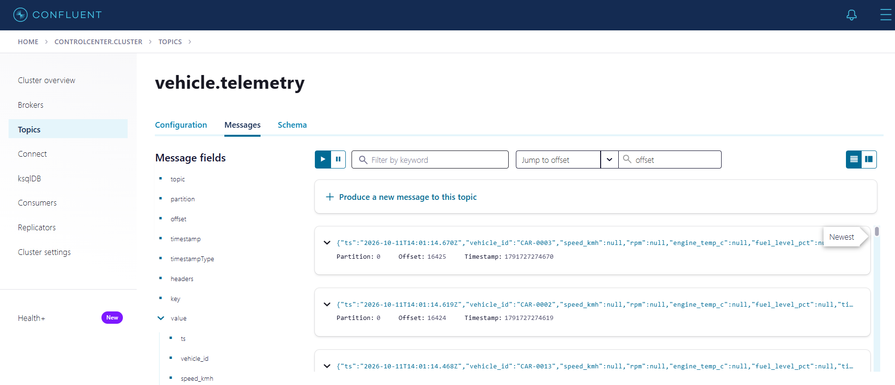

## 13. Vérification HDFS

Afficher les DataNodes actifs :

```bash
docker compose exec namenode hdfs dfsadmin -report
```

Lister les fichiers produits par Spark :

```bash
docker compose exec namenode \
  hdfs dfs -ls -R /lambda/raw/telemetry
```

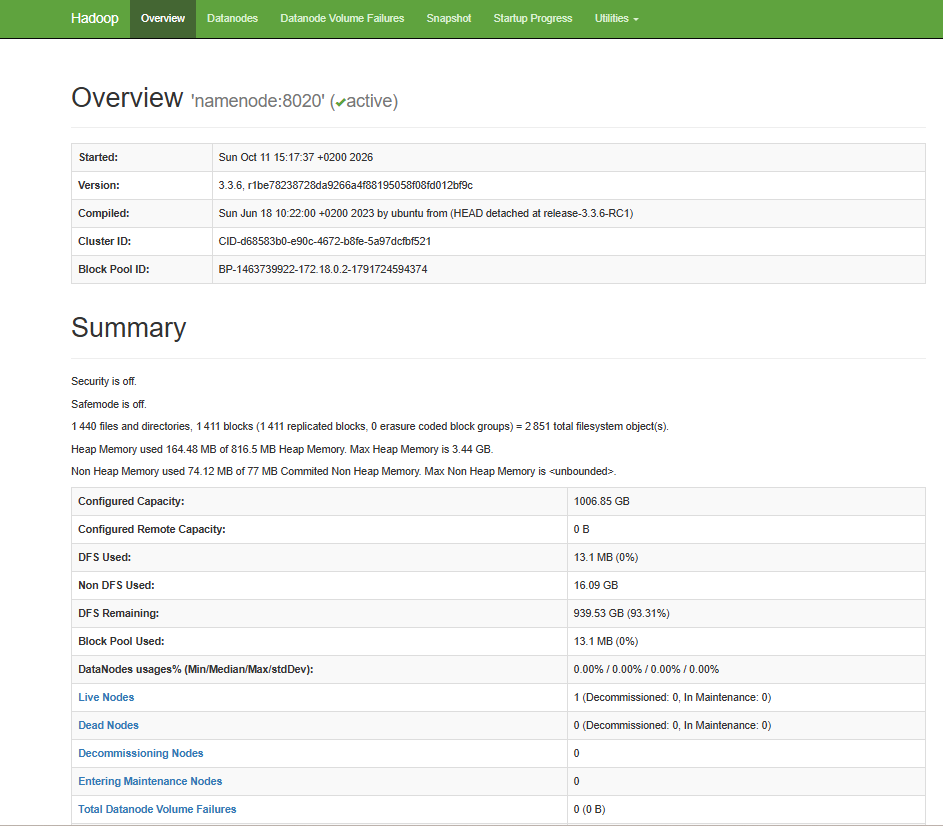

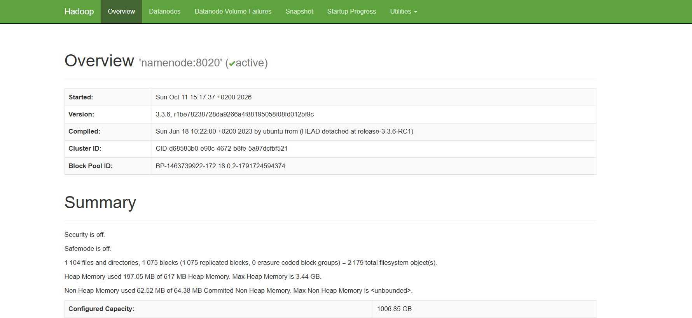

## 14. Vérification Cassandra

Afficher les vues temps réel :

```bash
docker compose exec cassandra cqlsh \
  -e "SELECT * FROM fleet.realtime_view LIMIT 5;"
```

Afficher les événements bruts :

```bash
docker compose exec cassandra cqlsh \
  -e "SELECT * FROM fleet.all_data_view LIMIT 5;"
```

Afficher les résultats batch :

```bash
docker compose exec cassandra cqlsh \
  -e "SELECT * FROM fleet.batch_view LIMIT 5;"
```

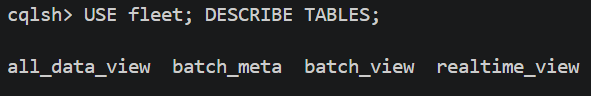

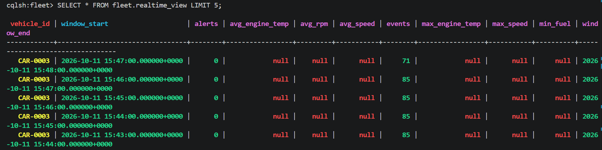

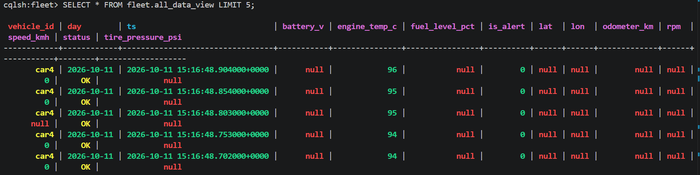

## 15. Connexion avec Beekeeper Studio

Créer une connexion Cassandra avec les paramètres suivants :

| Champ | Valeur |
|---|---|
| Type | Cassandra |
| Host | `localhost` |
| Port | `9042` |
| Keyspace | `fleet` |
| Authentification | Aucune |
| Utilisateur | Vide |
| Mot de passe | Vide |
| SSL | Désactivé |

Le nom `cassandra` fonctionne à l'intérieur du réseau Docker. Depuis Beekeeper
Studio installé sur la machine hôte, utiliser `localhost`.

Requêtes de test :

```sql
SELECT * FROM fleet.all_data_view LIMIT 10;
SELECT * FROM fleet.realtime_view LIMIT 10;
SELECT * FROM fleet.batch_view LIMIT 10;
SELECT * FROM fleet.batch_meta;
```

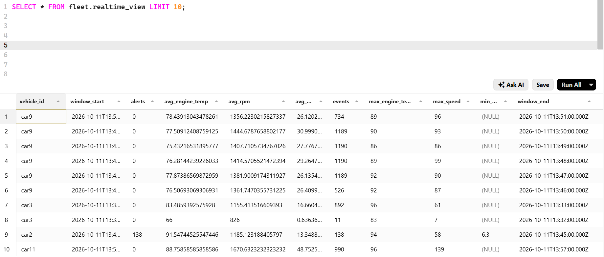

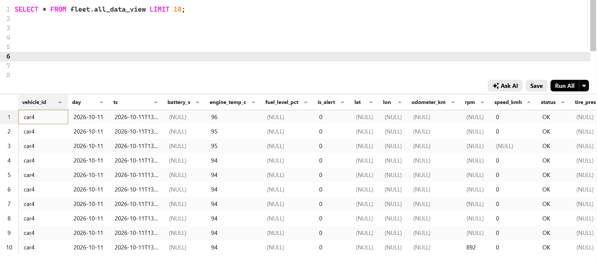

## 16. Traitement batch avec Airflow

Le DAG est défini dans :

```text
airflow/dags/lambda_batch_layer.py
```

Il est planifié toutes les quinze minutes. Pour le déclencher immédiatement :

```bash
docker compose exec airflow-webserver \
  airflow dags trigger lambda_batch_layer
```

Vérifier les exécutions :

```bash
docker compose exec airflow-webserver \
  airflow dags list-runs \
  --dag-id lambda_batch_layer
```

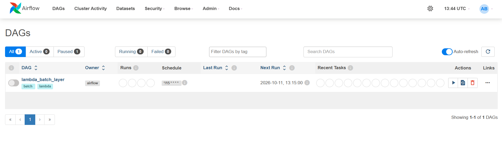

Vérifier les résultats :

```bash
docker compose exec cassandra cqlsh \
  -e "SELECT * FROM fleet.batch_view LIMIT 10;"

docker compose exec cassandra cqlsh \
  -e "SELECT * FROM fleet.batch_meta;"
```

## 17. API FastAPI

Tester la documentation :

```bash
curl http://localhost:8000/docs
```

Résumé d'un véhicule :

```bash
curl http://localhost:8000/vehicles/CAR-0001/summary
```

Dernier événement :

```bash
curl http://localhost:8000/vehicles/CAR-0001/latest
```

Top des alertes :

```bash
curl "http://localhost:8000/realtime/top-alerts?limit=10"
```

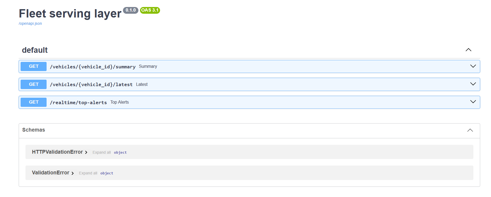

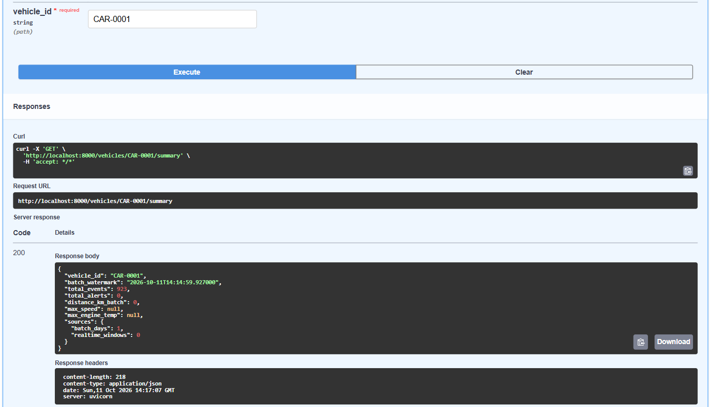

## 18. Dépannage

### Zookeeper reste `unhealthy`

Vérifier que le healthcheck utilise le port et non la commande `ruok` :

```yaml
healthcheck:
  test: ["CMD-SHELL", "nc -z localhost 2181"]
  interval: 10s
  timeout: 5s
  retries: 10
  start_period: 20s
```

Recréer le conteneur :

```bash
docker compose rm -sf zookeeper
docker compose up -d zookeeper
```

### Kafka s'arrête avec `ConfluentMetricsReporter cannot be found`

Ne pas activer les variables suivantes avec la configuration actuelle :

```yaml
# KAFKA_METRIC_REPORTERS
# CONFLUENT_METRICS_REPORTER_BOOTSTRAP_SERVERS
# CONFLUENT_METRICS_REPORTER_TOPIC_REPLICAS
# CONFLUENT_METRICS_ENABLE
```

### NameNode non formaté

```bash
docker compose run --rm --no-deps namenode \
  hdfs namenode -format -force
```

### HDFS ne voit aucun DataNode

Vérifier les permissions :

```bash
docker run --rm \
  -v lambda-fleet_namenode-data:/mnt/name \
  alpine:3.20 \
  sh -c 'chown -R 1000:100 /mnt/name && chmod -R u+rwX /mnt/name'

docker run --rm \
  -v lambda-fleet_datanode-data:/mnt/data \
  alpine:3.20 \
  sh -c 'chown -R 1000:100 /mnt/data && chmod -R u+rwX /mnt/data'
```

### Réinitialisation complète

Cette commande supprime toutes les données persistantes du projet :

```bash
docker compose down -v
docker compose up -d --build
```

## 19. Arrêt et redémarrage

Arrêter les services en conservant les données :

```bash
docker compose stop
```

Supprimer les conteneurs et le réseau, sans supprimer normalement les volumes :

```bash
docker compose down
```

Relancer le projet :

```bash
docker compose up -d
```

## 20. Captures disponibles

Les captures importantes sont regroupées dans le dossier
[`Projet_Lambda/`](Projet_Lambda/).

Elles couvrent notamment :

- l'architecture Lambda ;
- le démarrage Docker ;
- Kafka et les topics ;
- les messages Kafka ;
- l'interface HDFS ;
- les fichiers HDFS ;
- Spark Ingest ;
- Spark Speed ;
- le DAG Airflow ;
- les tables Cassandra ;
- les résultats Beekeeper ;
- les tests de l'API.
